<p align="center">
  
</p>

<h1 align="center">MC 汉化工坊</h1>

<p align="center">
  面向《我的世界》模组、服务器插件、光影包、资源包与整合包任务书的 AI 汉化桌面工具
</p>
<p align="center">
  <a href="https://get.microsoft.com/installer/download/9p9bn1lhbjk4?referrer=appbadge" target="_self">
    
  </a>
</p>

<p align="center">
  
  
  
  
</p>

<p align="center">
  <a href="#快速开始">快速开始</a> ·
  <a href="#任务书">任务书</a> ·
  <a href="#深度扫描">深度扫描</a> ·
  <a href="#服务商与模型">服务商与模型</a> ·
  <a href="#日志">日志</a> ·
  <a href="#数据与缓存">数据与缓存</a> ·
  <a href="#常见问题">常见问题</a> ·
  <a href="#开发者工具可选版本">开发者工具</a> ·
  <a href="#项目架构">项目架构</a> ·
  <a href="#开发与构建">开发与构建</a> ·
  <a href="#版本记录">版本记录</a>
</p>

---

MC 汉化工坊基于 Tauri v2 + React + TypeScript + Rust 构建，当前发布 Windows x64 安装包，其他平台可从源码自行构建。

把内容包拖进窗口（模组 jar / 服务器插件 jar / 光影包 zip / 资源包 zip / 整合包 zip 或 **`config/ftbquests` 任务书文件夹**），程序自动解析可翻译文本，结合上下文完成 AI 汉化，再导出为汉化 jar、光影包、资源包，或直接写回任务书的章节文件。切换到「游戏目录」模式可直接扫描 `.minecraft`，按游戏版本批量导入上千个内容包，列表按「**游戏版本 → 内容包 → 具体条目**」三级组织，折叠的内容不渲染。

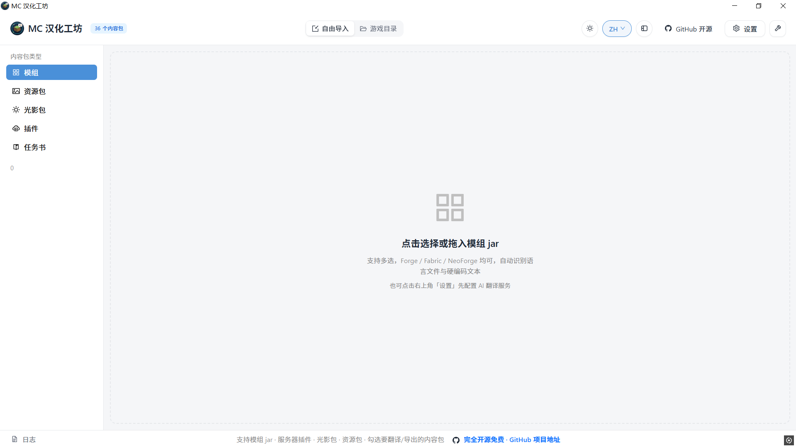

> **⚡ 实测速率**：付费模型智谱 `glm-4.5-air` + 并行加速，约 **110 秒**完成 3 个内容包共 350 条翻译。
> 实际速率因模型、网络与服务商限流而异；**免费模型大概率因限流无法开启并行与内容包并行**，建议单线程或低并发使用。

---

## 功能一览

| 功能 | 说明 |
|---|---|
| 五类内容包 | 模组 jar、服务器插件 jar、光影包 zip、资源包 zip，以及整合包**任务书**（FTB Quests）—— 自动探测类型，插件按 `plugin.yml` 等清单与模组区分 |
| 游戏目录模式 | 扫描 `.minecraft` / `versions` / 任意文件夹，按版本分组批量导入，含任务书识别；扫描结果带内存 + 磁盘缓存；上千内容包不卡顿 |
| 三级列表 | 游戏目录导入的内容按「游戏版本 → 内容包 → 条目」组织，父级可折叠；**折叠的节点不渲染**，直接导入的内容保持两层平铺 |
| 智能解析 | 语言文件、插件清单与配置、光影设置、资源包描述、任务书 SNBT 各自解析；兼容大小写、缩进、顶层文件夹包装等结构变体，自带中文自动识别并回填 |
| AI 翻译 | 五类内容各自差异化提示词（模组 / 插件 / 光影 / 资源包 / 任务书语境），自定义术语表与提示词锁定译名风格，占位符与格式码校验 |
| 深度扫描 | 可逐条开关的规则（15 条分三组，模组与插件各一套），挖掘成就、配置、嵌套 jar 与 `.class` 常量池文本；支持自定义规则、模板与规则档案、规则测试台 |
| 搜索与筛选 | 按当前类型逐词搜索，状态一键多选，与搜索词取交集；卡片标签点击即筛选 |
| 批量与并行 | 条目级勾选、拖动框选；单包 1-8 线程 + 多包同时翻译，支持暂停 / 取消 / 恢复 |
| 多服务商 | 12 家预设（含**本地推理 Ollama / llama.cpp，免 API Key**）+ 任意多个自定义服务商；Key 与模型各自独立保存，一键拉取模型列表、验证连接 |
| 多种导出 | 汉化模组 jar / 插件 jar / 光影包 / 改描述资源包 / 合并资源包；任务书按指针**原位写回**章节文件；文件名按命名偏好生成 |
| 会话恢复 | 列表按内容包分片自动缓存，崩溃或意外关闭后可一键恢复（含译文与进度） |
| 会话日志 | 左下角「日志」：级别筛选、搜索、导出本次会话、打开日志文件夹；默认自动记录，敏感信息写入前自动脱敏 |
| 本地数据管理 | 「关于 → 本地数据」显示缓存 / 用户数据 / 日志各自占用与目录，可一键清除（只作用于软件自身数据目录） |
| 双语与主题 | 中英文界面 + 明暗主题独立切换，与**无字模式（只留图标）**一起放在顶栏即时开关里 |
| 开发者工具（可选版本） | 独立窗口 8 个面板：事件流、命令调用、请求/响应、重试链、调度视图、故障注入、解析器测试台、导出预览器 |

---

## 快速开始

1. **下载安装**：从 [Releases](https://github.com/adssadax-1/mc-content-localizer/releases) 下载 Windows x64 安装包（NSIS 或 MSI），或 clone 源码自行构建。
2. **配置服务**：右上角「设置」→ 选择服务商 → 填入 API Key → 获取模型列表 → 选择模型 → 保存。用本地模型（Ollama / llama.cpp）则免 Key。
3. **导入内容包**：把文件拖进窗口，或点击中央区域选择。拖入**文件夹**时程序先判断它是不是任务书目录（`config` / `ftbquests` / `quests`），是则直接解析任务书，否则切到「游戏目录」模式逐级扫描。整合包 zip 会先检测其中的任务书，检测不到才按普通压缩包处理。

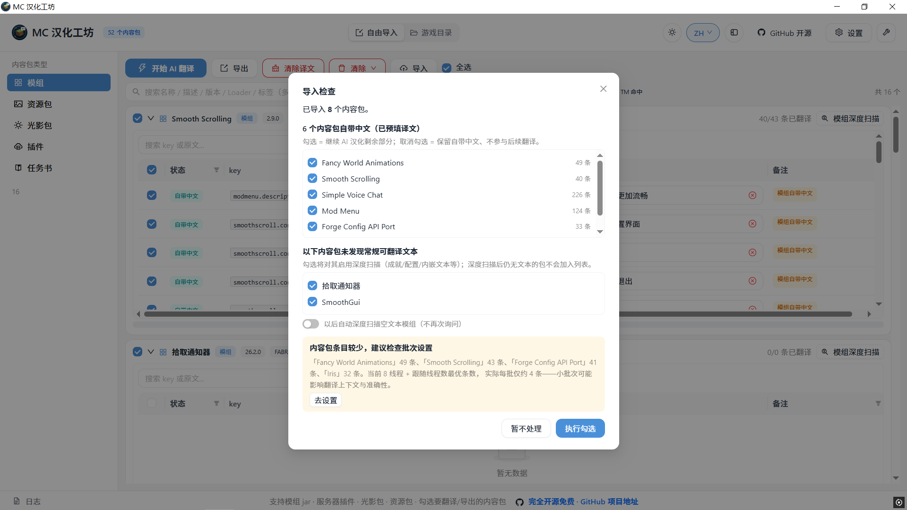

4. **开始翻译**：勾选需要翻译的内容包，点击「开始 AI 翻译」，进度条实时估算剩余时间。

翻译过程中条目按状态实时着色（翻译中 / 已汉化 / AI 未返回 / 翻译失败）：

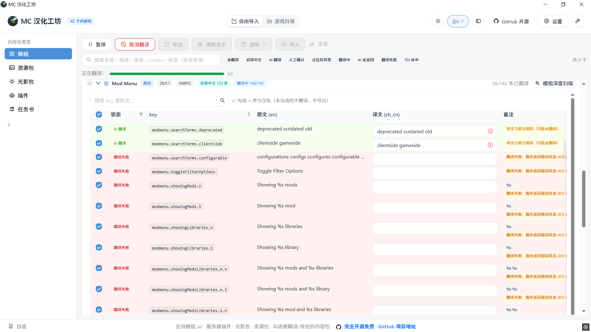

结束后汇总本次结果与针对性建议：


5. **人工审校**：表格里点击译文即改；单元格右侧可单条清除重译；工具栏「清除 ▾」可清空当前类型列表或清除勾选的内容包。


按住表格行内空白处（原文 / key / 状态列）上下拖动可框选批量勾选，从已勾选行开始拖则批量取消，拖到边缘自动滚动（复选框、按钮、输入框等交互元素不触发框选）：

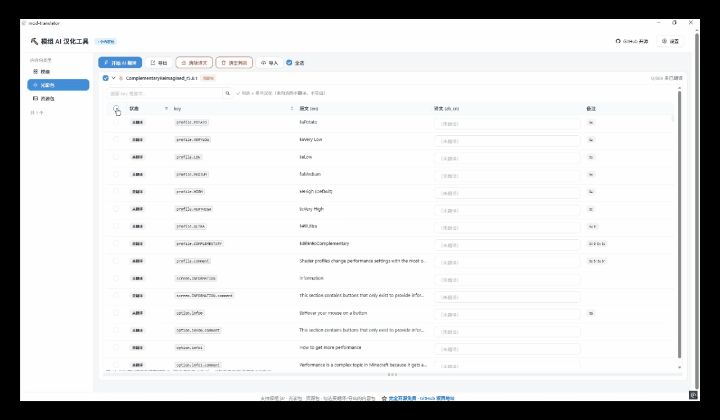

6. **导出**：点击「导出」，按勾选内容的类型自动分流——
   - **模组**：合并汉化资源包（一个 zip 管所有勾选模组）/ 汉化 jar（不覆盖原文件）
   - **服务器插件**：汉化 jar（`plugins/<插件名>_zh_cn.jar`，YAML 保持注释与键序）
   - **光影包**：`xxx_zh_CN.zip`；**资源包**：改描述后的资源包
   - **任务书**：磁盘来源直接**写回原文件**（首次写回自动备份 `.zhbak`）；整合包 zip 来源另存 `_zh_cn.zip`
   - 文件名跟随「导出命名偏好」（原名 / 原名_zh_cn / AI 汉化名称），同名自动加序号；导出完成的通知里可一键打开所在文件夹

> 1.12.2 及更早版本若游戏内中文显示为方块，需要自行安装字体修复类资源包（与本程序无关）。

### 顶栏即时开关（主题 / 语言 / 无字模式）

右上角三个按钮直接切换外观，点一下即改，不必先进设置再保存；图标本身表达当前状态：

- **主题**：亮色 / 暗色（太阳 / 月亮）
- **语言**：按钮显示当前语言码（ZH / EN），点开即切
- **无字模式（只留图标）**：把顶栏、侧栏、主工具栏、页脚的文字原地收起只留图标，给窄窗口和内容本身腾地方；内容区（译文表格、术语表、卡片）一字不动，所有图标按钮都有悬停名称与读屏名

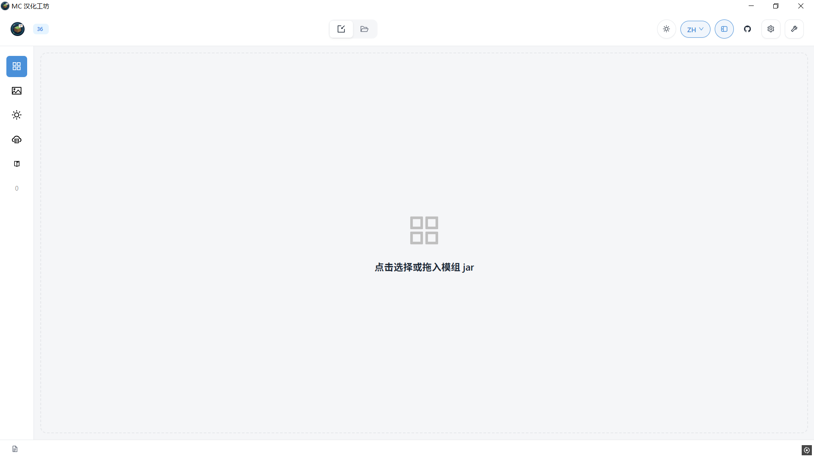

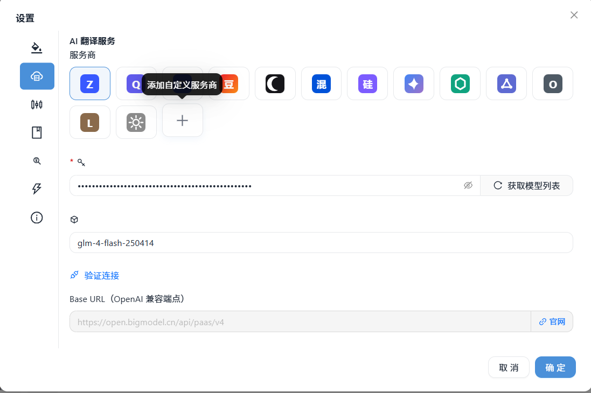

### 个性化设置

设置 →「个性化设置」只留「需要想一下、适合一并保存」的几项——主题与语言已移到顶栏即时开关，深度扫描另立设置页：

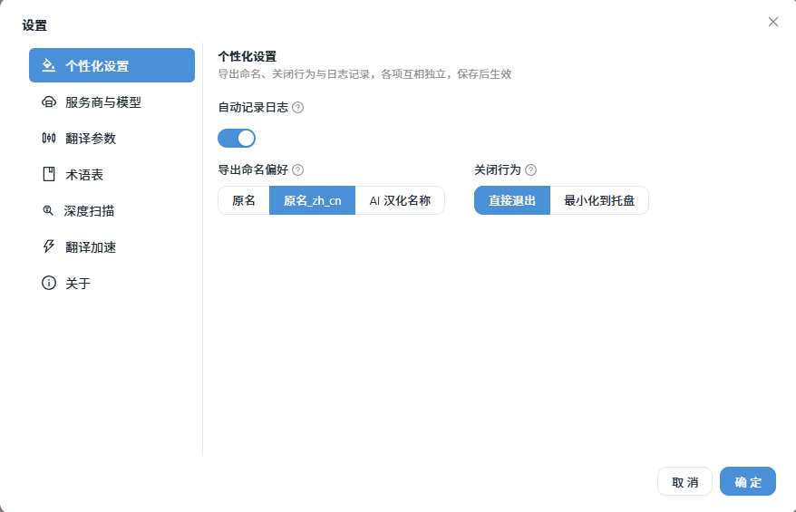

- **自动记录日志**（默认开启）：把本次运行的解析 / 翻译 / 导出 / 报错记到软件自己的数据目录；关掉只停止记录，**不会删除已有日志**
- **导出命名偏好**：原名（与源文件同名，可直接替换加载）/ 原名_zh_cn（默认）/ **AI 汉化名称**（翻译时让模型起一个简洁中文名，如 `机械动力_汉化.jar`；只有这一档才会产生额外的命名请求）
- **关闭行为**：直接退出，或最小化到托盘（托盘菜单可恢复窗口 / 退出）
- **记住上次停留的设置分组**：关闭设置再打开会回到上次那一页（只记住页面，不写入磁盘）

### 会话恢复

内容包列表自动缓存：软件崩溃、意外关闭或正常退出后再打开，会询问是否恢复上次的列表（含译文与进度）。缓存**按内容包分片存储**，只重写发生变化的那一片，恢复不依赖原包文件仍在。

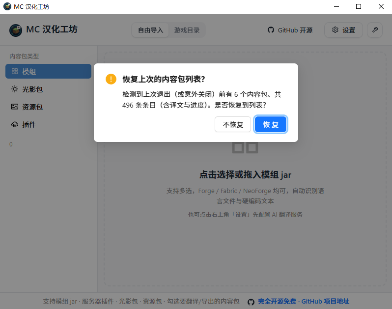

### 游戏目录模式

顶栏切换到「游戏目录」，选择 `.minecraft`、`versions` 或任意文件夹，程序递归找出所有版本分组（模组 / 插件 / 资源包 / 光影包 / 任务书分列计数）；直接指向 `mods`、`resourcepacks`、`shaderpacks` 或任意内容包文件夹也能识别（`.jar` / `.zip` 按内容自动分类）。

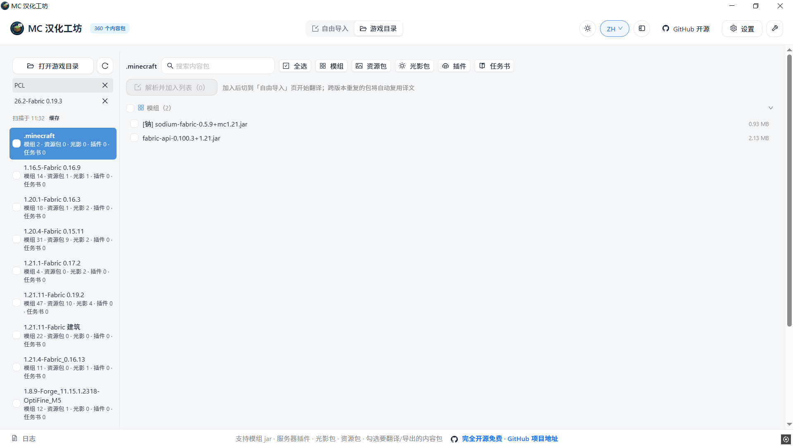

左侧版本行可整体勾选，分类与选择面板均可折叠展开、旁边勾选框全选对应范围；勾选后「解析并加入列表」逐包入队，后续翻译、导出与自由导入一致，跨版本、跨包译文自动复用，导出自动按版本建子目录。

扫描结果会缓存（内存 8 条 + 落盘 `scan-cache-gamedir.json`），切回「最近目录」不再重跑进度条，重启软件也不必重扫；左栏常驻「扫描于 14:52」与「缓存」标签标明结果来源与时间。「重新扫描」忽略缓存强刷当前目录，失败或被取消时保留旧结果与旧缓存。

> 扫描缓存是**按目录**缓存的，升级后任务书等新识别项不会自动出现在旧缓存里 —— 点一次「重新扫描」即可。

### 内容包列表：三级树

从游戏目录加入的内容按「**游戏版本 → 内容包 → 具体条目**」三层组织：版本父级行可展开/折叠，展开后是该版本的内容包卡片，卡片再展开才是条目表格。**直接导入**的内容包（jar / zip / 文件夹 / 任务书）不套版本层，仍是「内容包 → 条目」两层，与游戏目录的内容之间有一条分隔线区分。

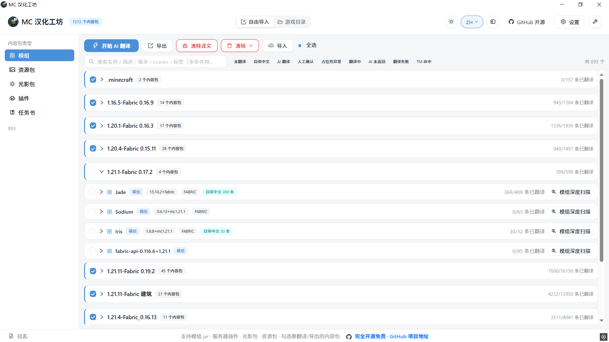

- **按需渲染**：折叠的版本不创建任何内容包卡片、折叠的卡片不创建条目表格 —— 上千个内容包全部折叠时，界面上只有若干行版本父级
- **父级勾选框**：三态（全选 / 半选 / 未选），一键全选或取消该父级**当前筛选范围内**的全部内容包；筛选之外的隐藏内容不受影响
- **默认折叠、不自动展开**：导入后不展开、搜索命中也不展开，展开与否只由点击决定；展开状态按内容类型分别记忆
- 切换内容类型时父级行按序错峰入场

---

## 任务书

整合包的任务书（FTB Quests）文本不在语言文件里，而是**内联**在 `config/ftbquests/quests/` 的 SNBT 文件中。程序把它作为第五类内容包处理，与模组、资源包、光影包、插件并列，并按「**整合包 → 章节（内容包）→ 条目**」组织：

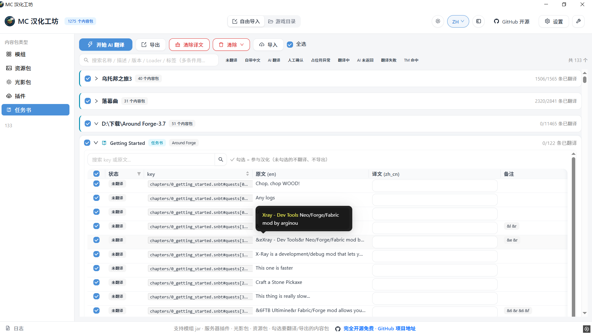

- **导入**：游戏目录扫描自动识别并归入所属版本；也可以直接拖入整合包 zip，或直接拖入 `config` / `ftbquests` / `quests` 文件夹。整合包 zip 的检测判据是「存在 `…/ftbquests/quests/chapters/*.snbt`」——光影 / 资源包 / 普通模组 / 普通压缩包都不会被误判；检测不到就完全走原有导入逻辑
- **层级**：任务书的最上层父级是**整合包名**（不是游戏版本号），三种导入方式一致；实例目录名形如 `1.21.11-Fabric 0.19.2` 时自动改用任务书标题。父级带勾选框，可一键全选/取消该整合包当前筛选范围内的全部章节
- **导出**：按条目指针**原位写回**章节 SNBT；整合包 zip 来源不写回原包，而是另存 `_zh_cn.zip`
- **格式码预览**：原文与译文都支持 `&` / `§` 颜色与格式码的悬停预览 —— 上图里鼠标停在 `&eXray - …` 上，弹出的深色提示框就是渲染后的真实效果

<details>
<summary>点击展开：任务书的解析范围与导入细节</summary>

**会被提取为可翻译条目的字段**（只读 `chapters/*.snbt`）：

| 位置 | 字段 | 说明 |
|---|---|---|
| 章节文件根级 | `title` | 章节标题 |
| 每个任务 | `title` / `subtitle` | 任务标题与副标题 |
| 每个任务 | `description[]` | 任务描述，逐行成条（空行自动跳过） |
| 图片元素 | `hover[]` | 图片悬停提示文本 |

条目 key 形如 `chapters/0_getting_started.snbt#quests[3].description[1]`——文件相对路径 + 指针，因此写回时能精确落到那一行文本上。

**暂未纳入翻译的文本**：任务书总标题（`data.snbt` 的 `title`，目前只作为「整合包父级」的展示名）、章节分组名（`chapter_groups.snbt`）、奖励表标题（`reward_tables/*.snbt`）。

**写回是怎么做的**：SNBT 不是标准 JSON（键可不带引号、元素以换行分隔），所以程序**不做结构化重排**，而是解析时记住每个字符串的字节区间，写回时按区间原位替换 —— 任务 ID、依赖关系、缩进与排版一字不动。首次写回前会把原文件备份为 `<文件名>.snbt.zhbak`。

**专属提示词**：任务书使用独立的提示词模板（叙事文风 + `&` 色码 / `{@pagebreak}` 分页标记保留 + 逐行结构保留），可在「自定义提示词 → 任务书」里改成自己的版本，与模组等类型互不混用。

</details>

---

## 深度扫描

深度扫描用于挖掘「常规解析」之外的内嵌文本（成就、配置、代码常量等）。它由一组**可逐条开关的规则**控制，模组与插件各持一套：

| 分组 | 规则 | 默认 |
|---|---|---|
| 扫描范围 | 扫描 JSON / `.lang`、`.properties` / 配置文件与文本 / 递归嵌套 jar / 提取 `.class` 代码内文本 | 代码内嵌：插件开、模组关 |
| 路径与语种 | 跳过元数据与许可文件 / **跳过语言文件本体（固定开）** / 跳过打包进来的第三方库 / 只取源语言与中文 / **中文一律保留（固定开）** | 全部开启 |
| 文本过滤 | 丢弃 SQL / 方法签名 / 日志句式 / 纯标识符 / 代码文本按可见性分级 | 全部开启 |

- **模板**：`推荐`（默认）、`精简`（只扫常规文本）、`全量（旧行为）`（含代码内嵌、关闭全部降噪过滤）
- **单包覆盖**：内容包卡片上悬停扫描按钮可见当前规则摘要与「本包含单独配置」；点齿轮为该包单独调整（只保存与全局的差异）。单包配置是**临时性**的：只保留在内存、不写入设置文件，重启或重新导入即回到全局规则；弹窗左下角「跟随全局设置」可一键清除
- **重扫合并**：按条目 key 合并，已有译文与勾选状态全部保留；规则变更后不再产出的条目若已有译文会保留并标注「规则已排除」
- **固定项**：嵌套深度 3 层、文本长度 3–200、「文本得像个可翻译的句子」的打分门槛，以及「单个词的标签需与 `Armour: ` 前缀同处一个类」这条闸门，都由引擎固定，不对外开放以免误调。**这也是「全量（旧行为）」不会给出一切的原因** —— 全小写词、纯标识符、没有前缀陪伴的孤立单词，切模板也不会出现

内容包卡片上的深度扫描按钮（悬停后出现齿轮，齿轮即单包规则入口）：


设置 →「深度扫描」里模组与插件各有独立入口，点开即配置（顶部为「自动深度扫描」总开关，下面是三组规则、模板与自定义规则）：


规则弹窗（以模组为例）：「内置规则 / 自定义规则 / 规则测试台」三个标签页，每条规则都带一句说明（扫什么、什么代价），锁定项标注为固定开启：

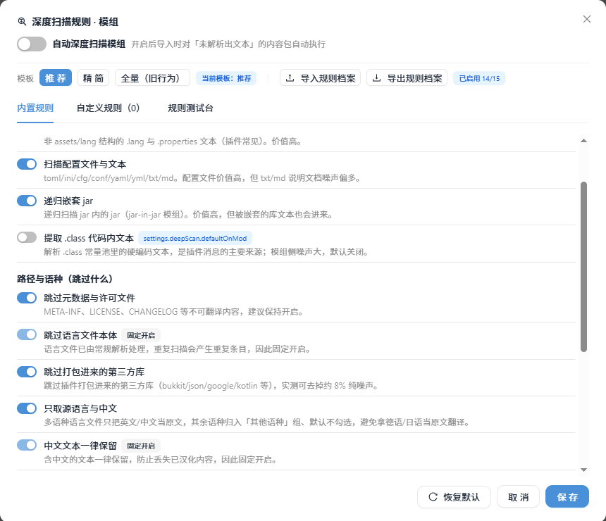

<details>
<summary>点击展开：快捷规则（从条目 Key 直接生成）</summary>

翻译表格里每条的 **Key 悬停**就会出现「深度扫描快捷规则」面板 —— 按这条条目所在的**文件或目录**一键生成深度扫描的包含 / 排除规则，不必回设置里手写通配符：


- 顶部是这条条目的**源文件路径**（可一键复制）；下面按「当前文件 / 当前目录 / 上一级目录 / 上两级目录」四层各给一对按钮（根级文件只有"当前文件"这一层）
- 点「包含」把该范围纳入深度扫描、点「排除」把它挡掉；同范围已有规则会列在「命中该路径的已有规则」里，可就地编辑 / 删除，停用的规则标注「停用中」
- 若该范围已被**上级目录的排除规则**覆盖，面板会直接写明「该范围已被上级排除规则覆盖（排除优先），包含不会生效」—— 免得你以为规则没起作用
- 自定义规则上限 20 条，重复规则会被挡下；「查看全部规则」跳到设置里的规则弹窗
- 只对**模组与插件**出现（这两类的扫描规则各自独立）

</details>

<details>
<summary>点击展开：代码内嵌文本（<code>.class</code>）支持范围</summary>

- **解析对象**：jar 内（含 `META-INF/jars/` 里嵌套 jar）所有 `.class` 文件的**常量池**——按 JVM 规范只读 `CONSTANT_Utf8` 字符串字面量，不加载类、不反编译，因此不需要该 jar 能运行、也不受 Java 版本影响
- **能提取到什么**：编译进代码的玩家可见文本——聊天与命令反馈、GUI/菜单标题与按钮、物品与计分板名称、Boss 血条与 Tab 标题、提示语与报错提示（带 `§`、`&a` 颜色码或 `%s`、`{0}` 占位符的最典型）
- **默认会被过滤掉什么**（「推荐」模板）：JVM 方法签名与类型描述符（`(...)V`、`Lnet/…;`）、SQL 语句、日志句式（`failed to load…`）、纯标识符/键名/权限节点、`minecraft:` 命名空间与 URL/路径样式、纯数字或纯 kebab/snake id、长度不在 3–200 字符内的，以及被打包进来的第三方库类（`bukkit/`、`google/`、`kotlin/` 等，由「跳过库类」规则控制）。**含中文的文本一律保留**
- **可见性分级**：开启「代码文本按可见性分级」后，含颜色码/占位符、本身就是成句（≥8 字符且含空格）、以及 `Armour: ` 这类**标签前缀**的文本，都归入「消息文本」组并**默认勾选**；**单个词的按钮文字**（`Armour` / `Shown` / `Glint` / `Nametags`…）只在同一个类里还存在这类前缀时才一并放行 —— 否则 NBT 与数据键（`Name`、`Color`、`Lore`、`SkullOwner`）会成批混进来，它们和按钮文字长得一模一样，被翻译后会让 `getString("Name")` 这类查表静默失配。其余归入「代码内嵌·其他」默认不勾选
- **默认开关**：插件**默认开启**（插件消息大多硬编码在代码里）；模组**默认关闭**（模组文本多数在语言文件内）。想尽可能少过滤，可切「全量（旧行为）」模板
- **⚠️ 资源包改不了这类文本**：资源包能覆盖的只有 `assets/<modid>/lang/` 下的语言文件。**写死在 `.class` 代码里的文字，无论怎么做资源包都不会生效** —— 唯一可行的路径是「导出汉化 jar」+ 打开「内嵌文本改写」。所以用合并资源包汉化某个模组时若发现按钮、提示仍是英文，先确认它不是被写死在代码里（见「常见问题 → 为什么有些文本没被扫到」第 3 条）

</details>

<details>
<summary>点击展开：规则档案（社区分享）的格式与校验</summary>

规则集可导出为 JSON 档案并分享给他人，格式如下（`rules` 与设置文件中的 `deepScanRules` 结构一致）：

```json
{
  "version": 1,
  "kind": "plugin",
  "name": "某服务器插件常用规则",
  "note": "面向 Bukkit 系插件，已过滤库类与日志句",
  "rules": {
    "scopeJson": true, "scopeLang": true, "scopeText": true,
    "scopeNested": true, "scopeClass": true,
    "skipMeta": true, "skipLangfiles": true, "skipLibs": true,
    "onlySourceLocale": true, "keepCjk": true,
    "dropSql": true, "dropDescriptor": true, "dropLog": true,
    "dropIdent": true, "classNeedsMarker": true,
    "custom": [
      { "id": "c1", "name": "SNBT 数据", "enabled": true, "kind": "ext",
        "pattern": "snbt", "action": "include", "source": "imported" },
      { "id": "c2", "name": "排除测试文本", "enabled": true, "kind": "textRegex",
        "pattern": "^(test|debug)", "action": "exclude", "source": "imported" }
    ]
  }
}
```

导入时程序会校验：档案版本不得高于当前支持版本、`kind` 必须与当前类型（模组 / 插件）一致、自定义规则逐条校验（正则语法、扩展名不得是二进制类型、名称与模式长度上限），非法规则被剔除并给出提示，内置规则整体套用。导入后的自定义规则与手写规则同等对待，可随时开关或删除。

</details>

---

## 翻译能力与加速

<details>
<summary>点击展开：并行加速、批次策略与译文质检</summary>

设置 →「翻译加速」：

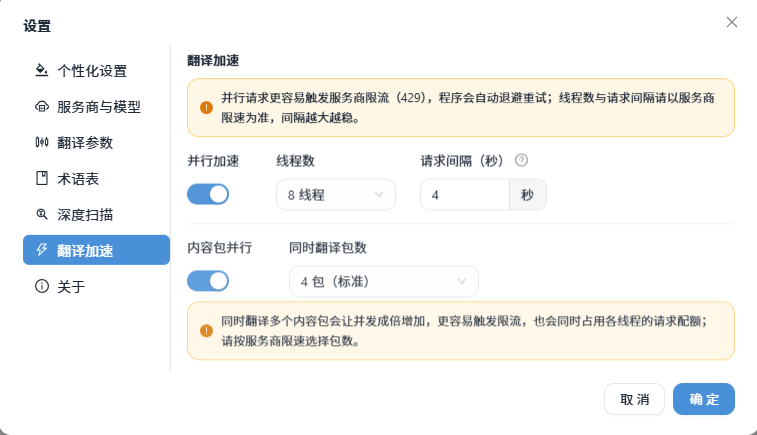

- **并行加速（线程数 1-8 + 请求间隔）**：并行发送翻译请求；间隔越大越不容易触发限流（推荐 ≥ 4s）
- **每批条数自动最优（默认开启）**：每批条数 = 待翻译条目数 ÷ 线程数；条目过少导致批次过小时会主动提醒
- **内容包并行翻译**：同时翻译 2 / 4 / 8 个内容包或无限制，每个内容包独立实时进度与完成提示
- **风险提示**：**免费模型大概率因限流无法开启并行与内容包并行**——免费模型通常有账号级速率限制，多线程 / 多包并发容易触发 429（程序会自动退避重试）。参考：OpenRouter 免费模型可开 8 线程，智谱免费模型（glm-4-flash 系列）建议 1-2 线程，付费模型可开 4-8 线程

翻译流水线本身还包含：跨内容包译文复用（相同原文直接复用，不重复调用）、占位符与格式码校验（丢失或改序会标在备注列）、「译文与原文相同」检测与一键清除重译、失败自动重试 + 429 退避、翻译期间按内容包分片落盘。

</details>

<details>
<summary>点击展开：术语表与自定义提示词</summary>

- **用户术语表**（设置 →「术语表」）：`原文 → 译文` 键值对，翻译时作为硬约束注入提示词，用于锁定专有名词译名
- **「先提取术语表」开关**（同一分组内，默认开启）：翻译前让模型从内容包中提取术语；关闭即完全不提取。提取结果在翻译完成汇总弹窗里勾选「加入术语表」，建议的高频词也可一键入表
- **自定义提示词**（「术语表」分组底部的按钮打开）：**五类内容各一套**（模组 / 光影包 / 资源包 / 服务器插件 / 任务书）分开定制，「可编辑段」开放修改、「核心段」（占位符规则、术语表注入、输出格式）系统锁定只读；支持一键恢复默认，改过的类型会显示「已定制」标记

</details>

---

## 日志

主界面左下角「日志」是本次运行的会话日志（一个会话一个文件，不做轮转与归档）：

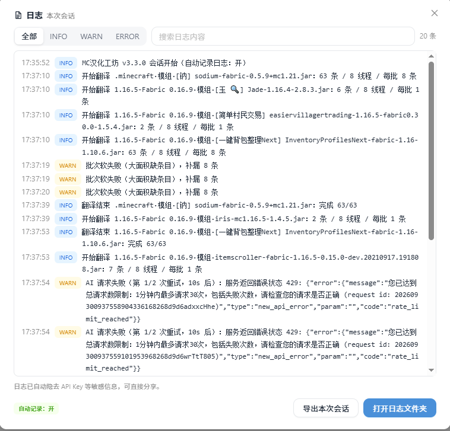

- **筛选与搜索**：按级别（全部 / INFO / WARN / ERROR）过滤，按关键字搜正文，右侧实时显示命中条数
- **导出本次会话**：把当前会话的日志写成一个 `.log` 文件
- **打开日志文件夹**：直接用系统文件管理器打开 `logs/` 目录
- **写入前脱敏**：API Key、`Authorization` / `Bearer` / `api_key=` 之类的写法都会先替换成 `***` 再落盘，日志可放心分享
- **界面异常也进日志**：错误边界捕获到的界面异常连同组件栈一并写入
- **与清理的关系**：清除缓存不动日志；清除用户数据默认也保留日志，只有第二步勾上「同时清除日志」才一起删

---

## 服务商与模型

在右上角「设置 → 服务商与模型」里配置，各服务商独立保存 Key、Base URL 与模型选择。

内置 **12 家预设**：云端 10 家（智谱 / 通义 / DeepSeek / 火山豆包 / Kimi / 腾讯混元 / 硅基流动 / Google Gemini / OpenAI / OpenRouter）+ 本地推理 2 家（Ollama / llama.cpp，免 API Key）。点「**添加自定义服务商**」还可添加**任意多个**自定义服务商（各自独立保存名称 / Base URL / Key / 模型，互不覆盖、可逐条删除）。

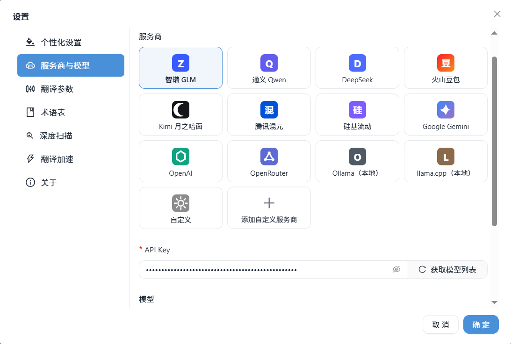

模型列表是可搜索下拉、免费模型带「免费」标注并优先排序；预设服务商的 Base URL 只读展示并附官网跳转；「验证连接」可一键检测所选 Key + 地址 + 模型是否可用。

<details>
<summary>点击展开：本地模型（Ollama / llama.cpp）</summary>

预设里带两家本地推理服务，**不用填 API Key**，模型名由你本地已拉取的模型决定：

| 服务 | 默认地址 | 说明 |
|---|---|---|
| Ollama | `http://localhost:11434/v1` | 模型名取自 `ollama list`；地址可改端口或走局域网 |
| llama.cpp | `http://127.0.0.1:8080/v1` | `llama-server` 默认免鉴权；模型名取自启动参数里的 `--alias` |

本地档做了几处针对性处理：

- **不发送 Authorization 头**：本地服务端本来就不校验；Key 留空即可保存，切回云端档时仍会要求填 Key
- **绕过系统代理**：机器上开着代理工具时，发往本机端口的请求不再被代理劫持（此前表现为本地模型莫名连不上）
- **超时放宽**：本地推理冷启动要加载权重、单并发还要排队，单请求超时比云端档宽松
- **响应解析更宽容**：不要求模型返回"完美 JSON"——带代码块围栏、夹着解释文字、甚至被截断的输出都能尽量读出可用条目；不回显条目 key、直接给原文也能对上；key 的大小写与空格差异不再导致漏条
- **批次自动补漏**：整批「有返回但不可用」时，只把未拿到的条目重发一次并追加更严格的格式要求
- **未翻译原因可辨**：备注列能区分「模型没有返回」与「返回了但内容不可用（具体原因）」

</details>

<details>
<summary>点击展开：各家 API Key 的申请步骤</summary>

**智谱 GLM（推荐：有免费模型，国内直连）**

1. 打开 [智谱开放平台](https://open.bigmodel.cn/) 注册并完成手机号实名认证
2. 进入控制台 →「API 密钥」→「创建新的密钥」
3. 复制 Key，在程序设置中选择「智谱 GLM」并粘贴，点击「获取模型列表」

免费模型：`glm-4-flash-250414`、`glm-4.7-flash`（有并发与每日额度，触发限流会自动退避重试）。付费模型按 token 计费。

**Google Gemini（免费层）**

1. 打开 [Google AI Studio](https://aistudio.google.com/apikey)，用 Google 账号登录
2. 点击「Create API key」生成 Key
3. 在程序设置中选择「Google Gemini」粘贴即可

注意：免费层有请求额度限制，内容可能用于训练，敏感数据请勿使用。

**DeepSeek（低价）**

1. 打开 [platform.deepseek.com](https://platform.deepseek.com/) 注册并充值
2. 左侧「API Keys」→「创建 API Key」
3. 在程序设置中选择「DeepSeek」粘贴

**阿里百炼 Qwen（低价）**

1. 打开 [阿里云百炼](https://bailian.console.aliyun.com/) 开通模型服务并完成实名
2. 控制台右上角「API-KEY」→ 创建
3. 在程序设置中选择「阿里百炼 Qwen」粘贴

其余服务商（豆包 / Kimi / 混元 / 硅基流动 / OpenAI / OpenRouter）同样是「官网拿 Key → 在设置里粘贴 → 获取模型列表」三步，各家的补充说明在选中后会显示在设置页对应位置。

</details>

<details>
<summary>点击展开：设置页的分组结构</summary>

设置左侧共 7 组：**个性化设置**（日志开关 / 导出命名偏好 / 关闭行为）· **服务商与模型**（预设网格 / Key / Base URL / 模型列表）· **翻译参数**（温度 / 每批条数）· **术语表**（自定义术语 / 术语提取开关 / 自定义提示词入口）· **深度扫描**（模组与插件各一套规则）· **翻译加速**（线程与间隔 / 内容包并行）· **关于**（版本、检查更新、本地数据清理）。各组的详细说明见本文对应章节。

</details>

---

## 数据与缓存

- **API Key 存储**：仅保存在本机配置文件（`%APPDATA%/com.administrator.mod-translator/settings.json`，macOS 为 `~/Library/Application Support/...`），不上传至任何第三方、不入仓库。日志会记录运行过程，但**写入前会把 Key 在内的敏感信息替换成 `***`**
- **翻译内容**：条目文本仅发送给你自己选择的服务商用于翻译
- **翻译质量提示**：AI 翻译仅供参考，建议导出前人工审校；专有名词可通过术语表锁定译名
- **设置损坏会被留档**：若 `settings.json` 解析失败，程序会先把它改名成 `settings.corrupt-<时间戳>.json` 再用默认值启动，原始内容不会被静默清掉

<details>
<summary>点击展开：本地数据位置与清理入口</summary>

程序不会往安装目录写任何文件，全部数据都在当前用户目录下（`<用户名>` 替换为你自己的账户名）：

| 位置 | 内容 | 大小 | 说明 |
|---|---|---|---|
| `%APPDATA%\com.administrator.mod-translator\settings.json` | 设置：API Key、模型与服务商、术语表、自定义提示词、翻译参数、主题语言、最近游戏目录、关闭行为 | 十几 KB | **不是缓存，是用户数据**。删除等于全部设置与 Key 重置 |
| `%APPDATA%\com.administrator.mod-translator\session-free-shards\` | 会话缓存：`index.json`（列表顺序 + 分片索引）与每个内容包一个分片文件（原文、译文、备注、勾选状态） | 与内容包数量成正比，每包几十至几百 KB | **唯一保存翻译成果的缓存**。崩溃或意外关闭后再次打开会询问是否恢复 |
| `%APPDATA%\com.administrator.mod-translator\logs\` | 会话日志：一次运行一个 `session-<年月日>-<时分秒>.log` | 每次运行几十 KB | 记录解析、翻译、导出、报错等过程（已脱敏） |
| `%APPDATA%\com.administrator.mod-translator\session-cache-free.json` | 旧版（≤ v2.3.x）整份会话缓存 | 可能几十 MB | 仅从旧版本升级上来时残留，可安全删除——v3.0.0 起改用上面的分片缓存 |
| `%LOCALAPPDATA%\com.administrator.mod-translator\EBWebView\` | 内嵌浏览器（WebView2）的缓存：网页缓存、GPU 着色器缓存、崩溃转储等 | 几十至一百多 MB（随使用增长） | **不含任何翻译数据**，可安全删除，程序会自动重建（首次启动略慢） |

**导出产物**不在上面：导出时会让你选择目录，文件写在你指定的位置。想保留译文与设置，备份 `%APPDATA%\com.administrator.mod-translator\` 整个目录即可（注意 `settings.json` 中 API Key 为明文，勿随意外传）。安装包卸载时不会自动删除上述目录，可在卸载前用「清除用户数据」先清干净。


「关于 → 本地数据」面板上会显示缓存 / 用户数据 / 日志各自占用与数据目录（可一键复制），并提供两档清理：

- **清除缓存**（1 次确认）：删会话缓存（上次的内容包列表快照）、游戏目录扫描缓存与 WebView2 浏览器缓存；设置、API Key 与已导出的产物都不受影响。会话快照删掉后，下次启动不会再询问「恢复上次列表」

  

- **清除用户数据**（2 次确认）：连 API Key、全部设置、术语表、AI 命名缓存一并删除，等于回到全新安装状态；完成后提示释放空间并提供「立即重启」。**日志默认不在删除范围内**，要一起删就在第二步勾上「同时清除日志」

  

  第二步是最后一道闸门：标题直接问「你确定你在干什么吗？」，**必须勾选「我已确认：删除以上全部数据，且无法恢复」，「执行清除」按钮才可点击**：

  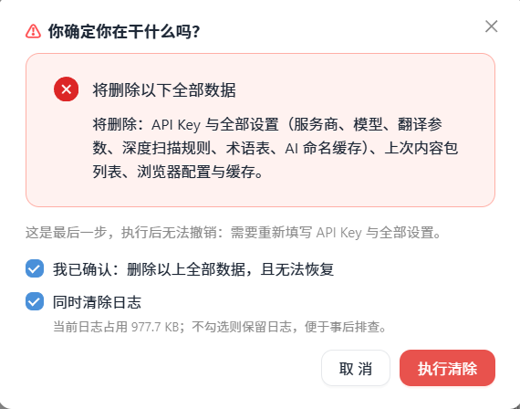

两档都**只作用于软件自己的数据目录**（上表两处，由程序按应用标识符解析，不接受任何外部路径）：游戏目录、导出目录、其他软件的文件一律不会被触碰。程序还会逐个校验目标路径确实位于这两个目录之内，路径不合法的一律跳过，被占用的条目跳过并在界面如实提示。

</details>

---

## 常见问题

<details>
<summary>Q：为什么有些文本没被扫到？</summary>

**先明确一点：文本扫不到，绝大多数是扫描规则的问题，而不是程序坏了。** 解析范围完全由你当前的规则决定 —— 规则里没打开的东西，程序不会去找它。按下面顺序排查，基本都能自己定位：

1. **它可能本来就不该出现** —— 写死在 `.class` 代码里的文字、纯配置项、SQL 语句、日志句式、权限节点之类，要么没有翻译价值，要么常规解析够不到（代码内嵌默认不扫，见第 3 条）
2. **被「推荐」模板的降噪规则过滤了** —— 默认会丢弃第三方库类文本、SQL、方法签名、日志句式、纯标识符等噪声。想尽可能少过滤，把该类型的模板换成「**全量（旧行为）**」，或针对具体路径加一条「包含」规则
3. **模组的 `.class` 内嵌文本默认关闭** —— 模组文本大多在语言文件里，所以代码常量默认不扫。需要就去「深度扫描 → 模组」把「提取 `.class` 代码内文本」打开
4. **扫描范围没覆盖这个文件类型** —— 「扫描范围」组里 JSON、`.lang` / `.properties`、配置文件与文本、递归嵌套 jar 各自独立开关；非常规扩展名要在「自定义规则」里加一条「包含」规则
5. **自定义规则把它挡掉了** —— **排除优先于包含**：只要命中任意一条「排除」规则就会被挡下，哪怕同时命中了「包含」。翻译表格里 Key 悬停会列出「命中该路径的已有规则」，被上级目录的排除规则覆盖时面板也会直接写明
6. **任务书只扫章节文件** —— 任务书总标题、章节分组名、奖励表标题目前不在翻译范围内（见「任务书 → 解析范围」）
7. **游戏目录用的是旧扫描缓存** —— 缓存里没有的类型（如升级后新增的任务书）不会自动出现，点一次「重新扫描」

**判断标准**：把该类型的模板切到「全量（旧行为）」、并把「自定义规则」里可疑的排除项逐个停用，再**重新扫描一次**。如果内容仍然不出现，那才是软件的问题 —— 这时请带上日志反馈（左下角「日志」→「导出本次会话」），能省下大量来回。

</details>

<details>
<summary>Q：免费模型翻译老是失败 / 报 429？</summary>

免费模型通常有**账号级并发与频率限制**，多线程或内容包并行很容易触发。建议：把线程数降到 1-2、内容包并行关掉、请求间隔调大（≥ 4s）。程序自身对 429 有自动退避重试与批次补漏，但仍受服务商额度限制。想要速度就换付费模型（智谱 `glm-4.5-air` 等）或本地模型。

</details>

<details>
<summary>Q：导出后在游戏里没生效？</summary>

按类型检查：

- **模组 jar**：生成的是新文件（不覆盖原 jar），需要自己替换 `mods/` 下的原文件
- **合并资源包**：把 `mods_zh_cn.zip` 放进 `resourcepacks/` 并在游戏里**启用**它；注意资源包只能覆盖 `assets/<modid>/lang/`，不影响其它文件。**写死在 `.class` 代码里的文字资源包永远覆盖不到** —— 那类文本只能走「汉化 jar」+「内嵌文本改写」这条路
- **服务器插件**：把 `plugins/<插件名>_zh_cn.jar` 放进 `plugins/`，并**删掉或改掉原插件 jar 的名称**（同名 jar 会冲突），或直接改名替换原文件
- **光影包**：`xxx_zh_CN.zip` 放进 `shaderpacks/` 后需在光影设置里重新选择
- **任务书**：写回模式下**改动的是整合包 `config/ftbquests` 里的原文件**，进游戏即生效；如果你在服务器 / 局域网联机，任务书内容以服务端为准

</details>

<details>
<summary>Q：升级后任务书没出现在游戏目录里？</summary>

游戏目录的扫描结果是**按目录缓存**的，旧缓存里没有任务书这一类。点左栏的「重新扫描」忽略缓存重扫一次即可；之后该目录就一直带着任务书了。

</details>

<details>
<summary>Q：出现「译文与原文相同」怎么办？</summary>

这是模型原样返回了原文（常见于短词、专有名词、或模型偷懒）。程序会自动检出并把原因写进备注列，可按备注列筛选后一键清除重译；也可以在术语表里为该词指定译名，或在条目上手动改。

</details>

<details>
<summary>Q：本地模型（Ollama / llama.cpp）连不上？</summary>

1. 确认服务已启动：Ollama 默认 `http://localhost:11434/v1`，llama.cpp 的 `llama-server` 默认 `http://127.0.0.1:8080/v1`
2. 换端口或跑在局域网另一台机器上时，把地址填进设置里的 Base URL（本地档的地址是可编辑的）
3. 程序已让发往本机端口的请求**绕过系统代理**；若你确实要走代理（例如服务在远端），改用「自定义服务商」填完整地址

</details>

---

## 开发者工具（可选版本）

提供独立构建的「开发者工具版」，安装后顶栏多一个工具按钮，点开为独立工具窗口，8 个面板全部实时：

<details>
<summary>点击展开：8 个面板与获取方式</summary>

| 面板 | 功能 |
|---|---|
| 事件流 | 所有 Tauri 事件实时时间线，可过滤、载荷展开收起 |
| 命令调用 | 每次 invoke 的命令 / 参数 / 状态 / 耗时 |
| 请求/响应 | 发送给模型的 System / User 提示词全文与响应原文 |
| 重试/降级链 | 429 退避、JSON 模式降级过程可视化 |
| 多线程调度 | 两级视图：内容包 → 线程，色块 = 批次，闪烁 = 进行中；条目按「版本 · 类别 · 包名」命名 |
| 故障注入 | 六类结果弹窗、断网 / 模拟 429 / 强制超时 / 延迟注入、时序测试、导出失败 |
| 解析器测试台 | 粘贴或导入语言文件即时解析，占位符校验，可导出 |
| 导出预览器 | 不写盘预览 zip 结构、文件名清洗、mcmeta 内容 |


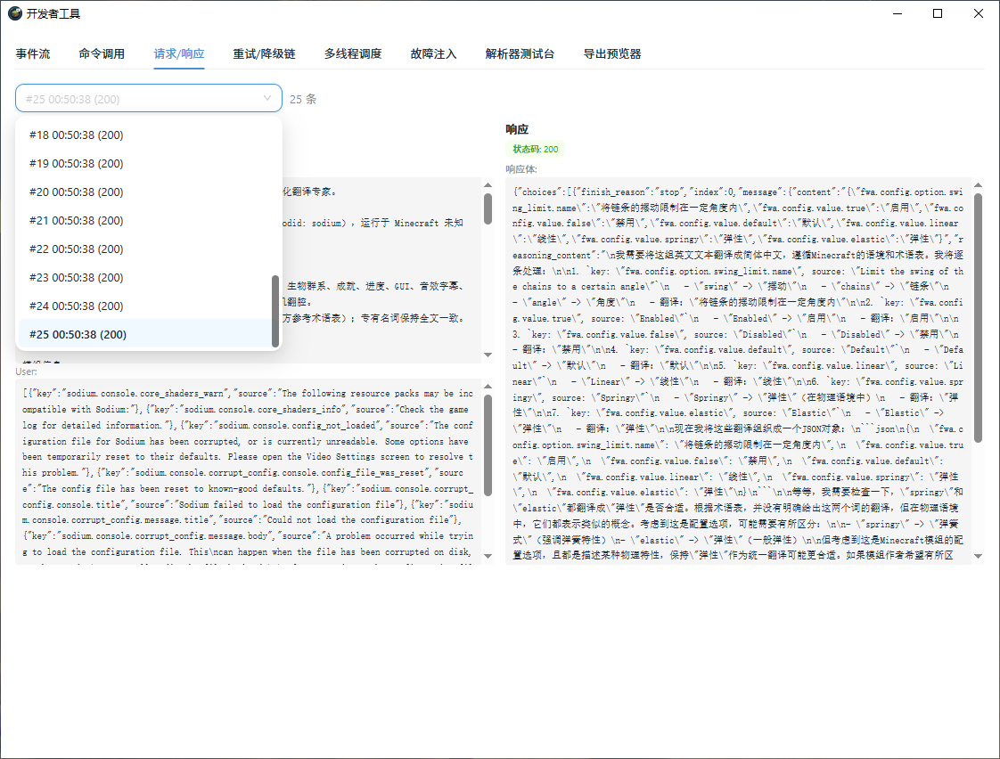

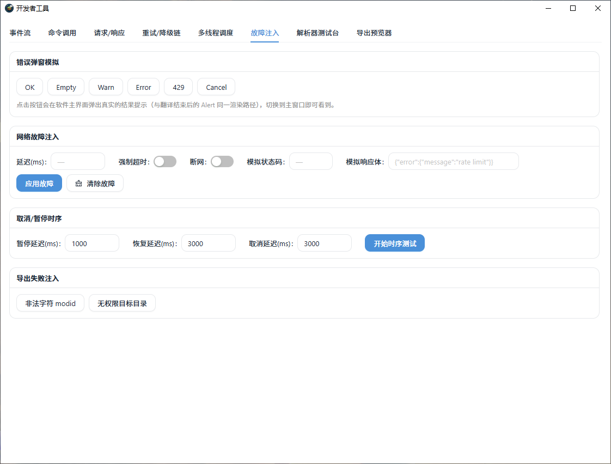

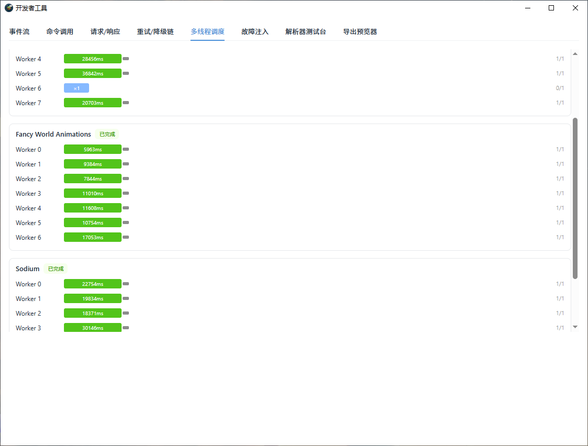

**获取方式**：Releases 下载带 `DevTools` 后缀的安装包（可与正式版共存安装），或源码构建见[开发与构建](#开发与构建)。正式版不含任何开发者工具代码。

开发版用的是独立应用标识符（`…mod-translator.devtools`），所以设置、会话缓存与日志都落在自己的目录里，与正式版互不干扰 —— 调试时不必担心弄脏正式版的配置与译文缓存。

</details>

---

## 项目架构

<details>
<summary>点击展开：目录结构与模块划分</summary>

本项目采用 Tauri v2 混合架构：前端使用 React + TypeScript 负责界面与交互，后端使用 Rust 负责文件解析、翻译流水线与导出。前后端通过 Tauri 的 invoke 命令与事件机制通信。

```
┌──────────────────────────────────────────────────────────────┐
│  前端（React + TypeScript）                                     │
│  ├─ App.tsx               主布局、内容包队列（三级树）、翻译/导出  │
│  ├─ components/           DropZone / EntryTable / GameDirView  │
│  │                        / SettingsModal / DeepScanRulesModal │
│  │                        / PromptEditorModal / DevToolsPanel  │
│  │                        / KeyRulePopover（Key 悬浮快捷规则）   │
│  │                        / LogsModal（会话日志页）              │
│  │                        / SlideNav / ProviderIcon /          │
│  │                          QuestIcon / LogIcon / DeepScanIcon  │
│  │                        / ErrorBoundary（界面异常兜底）等      │
│  ├─ kindMeta.tsx          五类内容包的图标与名称单一来源          │
│  ├─ gameDirScanCache.ts   游戏目录扫描缓存（内存 LRU + 写穿磁盘） │
│  ├─ devtools/             开发者工具独立窗口入口与事件契约        │
│  │                        （__DEVTOOLS__ 门控，生产构建剔除）     │
│  ├─ api.ts                Tauri invoke 与事件封装               │
│  ├─ i18n.tsx              中英双语（缺 key 回退中文）            │
│  └─ types.ts              类型定义、pack_format 版本对照、       │
│                           服务商预设                           │
├──────────────────────────────────────────────────────────────┤
│  后端（Rust / src-tauri/src）                                   │
│  ├─ commands.rs           Tauri 命令层（解析/翻译/导出/设置/清理/  │
│  │                        扫描缓存读写）                        │
│  │   └─ devtools 模块      dev_* 命令（仅 devtools feature）     │
│  ├─ dev.rs                devtools 插桩：事件广播/故障注入        │
│  │                        （feature 门控，生产零代码）            │
│  ├─ game_dir.rs           游戏目录扫描（版本分组、含任务书识别）    │
│  ├─ logging.rs            会话日志（内存缓冲 + 会话文件、脱敏）     │
│  ├─ storage.rs            本地数据统计与清理（缓存/用户数据/日志）  │
│  ├─ core/                 jar 解包、各类文本解析、扫描规则引擎     │
│  │   ├─ jar.rs            模组 jar 解析                         │
│  │   ├─ plugin.rs         服务器插件解析（清单 / 配置 / 语言）     │
│  │   ├─ pack.rs           光影包 / 资源包解析                    │
│  │   ├─ json_lang.rs      JSON 语言文件（1.13+）                │
│  │   ├─ lang.rs           legacy .lang 文件（1.12.2）           │
│  │   ├─ quest_book.rs     任务书 SNBT 解析与按指针原位写回         │
│  │   ├─ quest_zip.rs      整合包 zip 内的任务书检测与导出          │
│  │   ├─ placeholder.rs     占位符与格式码校验                    │
│  │   ├─ scan_rules.rs     深度扫描规则引擎（模板/自定义/规则档案） │
│  │   ├─ deep_scan.rs      深度扫描：JSON / 配置 / 嵌套 jar /      │
│  │   │                    `.class` 常量池文本                    │
│  │   └─ model.rs          通用数据模型                           │
│  ├─ translate/            AI 翻译流水线                         │
│  │   ├─ provider.rs       OpenAI 兼容客户端（含故障注入点）       │
│  │   └─ pipeline.rs       提示词模板、术语表提取、分批翻译、重试、校验│
│  ├─ export.rs             资源包 / 模组 jar / 插件 jar / 光影包导出 │
│  ├─ settings.rs           设置持久化（增量保存 patch_settings、    │
│  │                        迁移、损坏留档）                       │
│  └─ tauri.devtools.conf.json  开发版打包覆盖（独立 productName   │
│                           与 identifier，可与正式版共存安装）     │
└──────────────────────────────────────────────────────────────┘
```

</details>

<details>
<summary>点击展开：数据处理流程（从导入到导出）</summary>

```
导入文件 / 文件夹（拖入、选择，或游戏目录扫描）
   │  · 文件夹：先判断是否任务书目录（config / ftbquests / quests）→ 是则直接解析任务书
   │  · 整合包 zip：先检测其中的任务书（…/ftbquests/quests/chapters/*.snbt）→ 命中则按任务书入队
   │  · 游戏目录模式：扫描结果按目录缓存（内存 LRU + 落盘 scan-cache-gamedir.json），
   │    切回最近目录 / 重启软件命中缓存即复用；「重新扫描」忽略缓存强刷
   │
   ▼
类型探测（读内容判定，文件夹名只作提示）
   ├─ 模组 jar ────┬─ 元数据：mods.toml / fabric.mod.json / quilt.mod.json / mcmod.info
   │                └─ 语言文件：assets/<modid>/lang/*.json（1.13+）、*.lang（1.12.2 legacy）
   ├─ 服务器插件 jar ─┬─ 清单白名单：plugin.yml / paper-plugin.yml / bungee.yml
   │                  │   （description、usage、commands.*.description、permissions.*.description）
   │                  ├─ 候选配置与语言：.yml / .yaml / .properties / .json
   │                  │   （lang、locale、messages 等目录；命名含 message/lang/locale；根部 config.yml）
   │                  └─ 三层噪声过滤：键路径黑名单 → 值启发式 → 可见键放宽
   ├─ 光影包 zip ── shaders.properties / shaders/lang/en_US.lang
   ├─ 资源包 zip ── pack.mcmeta description（纯文本 / 组件树 / 多语言对象）
   └─ 任务书 ────── chapters/*.snbt 的 title / subtitle / description[] / hover[]
   │
   ▼
生成条目列表（原文 / key / 状态；命中自带中文语言文件的按键路径与叶子键回填并标「已有中文」）
   │
   ▼
深度扫描（手动点击，或按设置对未解析出文本的包自动执行）
   ├─ 规则决定读什么：扫描范围 / 路径与语种 / 文本过滤 三组规则 + 自定义规则
   │   （扩展名、文件名通配、路径通配、文本正则；「包含」为白名单、「排除」优先）
   ├─ 读法：JSON / MCMeta / bbmodel 结构化遍历；.lang / .properties 键值；其余按行文本
   ├─ 代码内嵌：读取 .class 常量池字符串（插件默认开、模组默认关）；递归嵌套 jar（≤3 层）
   └─ 结果按条目 key 与已有条目合并（译文与勾选保留；规则不再产出的条目有译文则标「已排除」）
   │
   ▼
用户勾选分组 / 逐条审校
   │  （外观与设置走各自入口即时落盘：顶栏开关与设置项按需增量保存，不整份写回）
   │
   ▼
开始翻译 ──► 术语表提取（可选，受设置开关控制）
            跨内容包译文复用（相同原文直接复用，不重复调用）
            内容包并行调度（2 / 4 / 8 个包同时翻译）
            每包分批翻译（1-8 线程，批次数自动最优；支持暂停 / 取消 / 恢复）
            占位符与格式码校验 + 「译文与原文相同」检测
            失败自动重试 + 429 退避
            翻译期间按内容包分片落盘，崩溃后可恢复
   │
   ▼
翻译完成汇总（原文一致 / 提取术语 / 术语建议 在一个弹窗内勾选后统一执行）
   │
   ▼
导出结果 ──► 文件名按命名偏好生成（原名 / 原名_zh_cn / AI 汉化名称；同名自动加序号）
            汉化模组 jar（替换语言文件，其余成员原字节保留）
            汉化插件 jar（plugins/<插件名>_zh_cn.jar；YAML 走文本级行替换，注释与键序保留）
            汉化光影包 zip / 改描述资源包 zip（统一 _zh_CN 后缀）
            合并汉化资源包 zip（多个模组合并为 mods_zh_cn.zip）
            任务书：磁盘来源按指针原位写回（首次备份 .zhbak）/ zip 来源另存 _zh_cn.zip
            游戏目录模式下按版本建子目录
   │
   ▼
会话日志（默认开启）──► 解析 / 翻译 / 导出 / 报错的每一步写入 app_config_dir/logs/
                        （脱敏后落盘，界面左下角「日志」可看 / 筛 / 搜 / 导出）
```

</details>

---

## 开发与构建

```bash
# 环境要求
# - Node.js 18+ 与 npm
# - Rust stable（rustup）
# - Windows: Visual Studio Build Tools（C++ 桌面开发工作负载）
# - macOS: Xcode Command Line Tools
# - Linux: webkit2gtk 等依赖

# 安装依赖
npm install

# 开发模式（热重载）
npm run tauri dev

# 开发模式（含开发者工具面板与 dev 命令）
npm run tauri:dev:devtools

# 运行 Rust 单元测试
cd src-tauri && cargo test

# 打包安装程序（NSIS/MSI 等，按平台）——正式版，不含开发者工具
npm run tauri build

# 打包含开发者工具的安装包（产品名独立，可与正式版共存安装）
npm run tauri:build:devtools

# 仅构建免安装版 exe（不打安装包）
npm run tauri build -- --no-bundle
```

---

## 开源协议

本项目使用 **MIT 协议**，详见 [LICENSE](LICENSE) 文件。

---

## 版本记录

### v4.0.1（2026-10）

**新增：内嵌文本改写（导出汉化 jar 时可开）**

- 有一类文本以前**永远汉化不了**：作者把文字直接写在代码里（编译进 `.class`），语言文件和资源包都够不到它。本版新增开关「**内嵌文本改写**」（**默认关闭**；位置：设置 → 个性化设置）。打开后导出汉化 jar 时会真的把这些字改掉。
- **只管这一类条目**：原本就能生效的（语言文件键、`fabric.mod.json` 这类 JSON 里写死的名字/描述）**一个字都不碰**；**开关关闭时不做任何 `.class` 改写**，字节码原封不动 —— 所以它是"极端情况的兜底"，不是常规流程。
- 同时充当**字段名 / 方法名 / 枚举名**的文字会被自动跳过（改掉会让模组直接崩），导出统计里会列出跳过条数。
- 打开开关后，那些本来永不生效的 `.class` 条目**不再写进语言文件**，所以语言文件条数会明显变少 —— 这是正常的，不是内容丢失。

**修复**

- **插件汉化会把 `.class` 写坏**：此前插件导出误把二进制成员当文本处理，产出 jar 里的 class 文件已损坏（模组侧只是"翻译无效"，插件侧是"文件坏了"）。现已按类型区分，二进制成员原样保留。
- **键名带 `.` 的 JSON 翻译后不生效**：这类键被误当成多层路径，导致静默写回原文。现已修正。
- **被一层文件夹包起来的 jar 汉化不生效**：路径比对口径不一致，导致永远匹配不上。现已修正。
- **部分 `.class` 内嵌文本扫不出来**：常量池解析漏读了约一半条目，现已修正。
- **按钮上的单词标签扫不到，界面只汉化了一半**：像 `Armour` / `Shown` / `Scope: ` 这种**单个词的按钮文字**，因为没有空格也没有颜色码，被旧的降噪打分整条丢掉（表现为「悬停提示都汉化了，按钮还是英文」）。现已识别这类「Title 词」与「标签前缀」并把它们归入默认勾选的「消息文本」。**为避免把 NBT / 数据键（`Name`、`Color`、`Lore` 等）也一并扫进来**（它们同属"只被 `CONSTANT_String` 引用的 Title 词"，被翻掉会让 `getString("Name")` 这类查表静默失配），单词型标签**只在同一个类里还存在 `Armour: ` 形式的前缀时才放行** —— 实测可去掉约 95% 的这类噪声，而真实 GUI 类的标签一个不丢。
- **扫出一堆永远改不了的 JVM 内部名**：`Code` / `LineNumberTable` / `SourceFile` 这些属性名在常量池里也是字面量形态，过去会混进条目列表、白花翻译额度，却注定在改写时被拒。现在扫描与导出**共用同一把尺子**，只收「只被 `CONSTANT_String` 引用、且不被当作名字」的文本。

### v4.0.0（2026-09）

> ⚠️ **升级提示**
> - 本版改动了内容包列表的数据结构（新增三级层级与任务书类型），**旧的会话缓存可能无法完整读取**。升级前建议先备份缓存目录（`%APPDATA%\com.administrator.mod-translator\`），或保留一份旧版本程序以便随时回退。
> - **游戏目录需要点一次「重新扫描」**：扫描结果有缓存，旧缓存里没有任务书等内容包，程序不会自动作废它 —— 重新扫描一次才能扫到任务书。

**任务书（整合包任务 / 剧情文本）汉化**

- 新增第五类内容类型「任务书」：识别 FTB Quests 任务书（`config/ftbquests/quests`），按「整合包 → 章节 → 条目」拆分入队；翻译范围是章节标题、任务标题/副标题/描述与图片悬停提示
- **三种导入方式**：游戏目录扫描自动识别（归入所属版本）、直接拖入整合包 zip（检测 `…/ftbquests/quests/chapters/*.snbt`，一个包里的多本任务书分别识别）、直接拖入 `config` / `ftbquests` / `quests` 文件夹
- **导出**：磁盘来源按条目指针**原位写回**章节 SNBT（只替换该条文本，结构、任务 ID、排版一字不动；首次写回自动备份 `.zhbak`）；整合包 zip 来源另存 `_zh_cn.zip`（复制原包仅替换汉化章节，原文件不动）
- **专属提示词**：任务书叙事文风 + `&` 色码 / `{@pagebreak}` 分页标记保留 + 逐行结构保留，与模组等类型互不混用
- 条目表格支持 `&` 与 `§` 两种格式码的**渲染预览**（悬停即见颜色、粗体、斜体、下划线等真实效果），原文列与译文列都有

**内容包列表：三级树**

- 游戏目录导入的内容统一为「游戏版本 → 内容包 → 具体条目」三级结构，版本父级可展开/折叠
- **按需渲染**：折叠的版本不创建任何内容包卡片、折叠的卡片不创建条目表格；上千个内容包全部折叠时只有若干行版本父级
- 任务书的最高父级是**整合包名**（不是游戏版本号），三种导入方式统一；实例目录名形如 `1.21.11-Fabric 0.19.2` 时自动改用任务书标题
- 父级行与内容包视觉分层：勾选框在最左、左侧强调边、更大字号与字重、更松留白、悬停底色
- 父级勾选框：三态（全选 / 半选 / 未选），一键全选或取消该父级**当前筛选范围内**的全部内容包
- 「游戏目录」与「直接导入」之间加分隔线；直接导入仍是原来的「内容包 → 条目」两层平铺，不套版本层
- **所有版本父级默认折叠、不自动展开**（导入后不展开、搜索命中也不展开，只由点击决定）；展开状态按内容类型分别记忆
- 切换内容类型时，父级行按序错峰入场

**搜索、筛选与批量勾选**

- 「全选」作用范围 = 当前类型页 + 当前搜索 / 标签筛选后的命中集；**累加式**：换筛选条件不会清掉已勾选的内容
- 各类型按自身数据扩充搜索字段：模组补作者与 MC 版本、光影补界面文本、插件补面向玩家的消息类文本；插件卡片补版本标签
- 卡片上的版本标签移除（父级节点已在显示它，避免把层级降级成标签）

**服务商**

- 自定义服务商支持保存**任意多个**（各自独立保存名称 / Base URL / Key / 模型），可逐条删除，互不覆盖
- **Base URL 按服务商分槽保存**：填自定义服务商的地址不再覆盖 Ollama / llama.cpp 已保存的地址
- 自定义服务商按需添加（「添加自定义服务商」按钮），不再有内置的空白「自定义」槽位

<details>
<summary>点击展开：更早的版本记录（v3.3.0 及以前）</summary>

### v3.3.0（2026-09）

- **会话日志**：主界面左下角新增「日志」入口——按级别（INFO / WARN / ERROR）筛选、按关键字搜索正文、显示命中条数、一键导出本次会话、打开日志文件夹；一次运行一个 `session-*.log`，解析 / 翻译 / 导出 / 报错全过程留痕
- **自动记录日志**：「个性化设置」新增开关，默认开启；关闭只停止记录，不删除已有日志。日志写入前自动脱敏（当前与历史保存的 API Key、`Authorization` / `Bearer` / `api_key=` 写法一律替换为 `***`），可直接分享
- **本地数据分档更清楚**：「关于 → 本地数据」把日志单列一项占用；**清除缓存不动日志**，清除用户数据第二步新增「同时清除日志」（默认不勾选，保留现场便于排查）
- **界面异常也进日志**：错误边界捕获到的界面异常连同组件栈一并写入会话日志
- **内容包详情页搜索 + 快速筛选**：搜索按当前内容包类型逐词匹配（如 `1.20.1 Fabric`）、状态标签一键多选（八种状态 + 翻译中，组合为并集），与搜索词取交集，实时显示命中数，可一键清除
- **标签点击即筛选**：卡片上的版本 / 加载器 / 已汉化 / 任务书书名标签点一下即加入筛选条件，再点取消；当前生效的条件高亮显示
- **Key 悬浮快捷规则**：翻译表格里的条目 Key 悬停即出规则面板——按所在文件 / 目录一键生成深度扫描的自定义包含或排除规则，显示会被哪条排除规则覆盖、同名规则一键跳转，就地编辑或停用；只对模组与插件生效

### v3.2.0（2026-09）

- **新增本地模型（Ollama / llama.cpp）**：免 API Key、不发送 Authorization 头，默认地址 `localhost:11434` / `127.0.0.1:8080`；模型名取自本地已拉取的模型
- **本地推理绕过系统代理**：开着代理工具时，发往本机端口的请求不再被代理劫持（此前表现为本地模型连不上）
- **本地档容错增强**：单请求超时放宽；响应解析不再要求"完美 JSON"——带围栏、夹解释文字、被截断的输出都能尽量读出条目，key 的大小写与空格差异不再漏条
- **批次自动补漏**：整批「有返回但不可用」时只重发未拿到的条目并追加更严格的格式要求，不再整批作废
- **未翻译原因可辨**：备注列区分「模型没有返回」与「返回了但内容不可用（具体原因）」
- **无字模式补齐**：服务商页各家提示段与本地档补充说明在无字档整段收起（常规档不动）；顶栏两条切换栏与同排按钮统一尺寸、图标同步放大
- **设置弹窗记住上次停留的分组**（仅内存，退出即复位）
- **修复**：顶栏垂直对齐——左上图标与标题、右侧一组按钮此前按文字基线对齐而上下错开，现统一按中轴对齐（常规与无字两档都生效）

### v3.1.1（2026-09）

- **无字模式（只留图标）**：顶栏一键把界面外壳（顶栏 / 侧栏 / 主工具栏 / 页脚）的文字收起只留图标，内容区一字不动；图标按钮同步放大，全部带悬停名称（含禁用态）与读屏名；全应用 38 处说明性灰字按需精简
- **顶栏即时开关**：主题 / 语言 / 无字模式移到右上角，点一下即改（图标表达当前状态）；「个性化设置」只留导出命名偏好与关闭行为
- **游戏目录扫描缓存**：扫描结果按目录缓存（内存 8 条 + 落盘），切回最近目录与重启软件都不必重扫；左栏显示「扫描于 14:52」与「缓存」标签；新增「重新扫描」忽略缓存强刷，失败时保留原结果
- **界面与动效**：模式切换双向动效；删除列表项改为「横向滑出 + 高度收起」；页签与服务商切换错峰滑入；服务商网格改纯图标；内容包类型图标收敛为单一来源；「开始 AI 翻译」按内容定宽；设置弹窗分组栏加宽、底色与页面同色
- **修复**：自定义规则保存后重启丢失；设置文件解析失败会清空用户数据（改为先留档）；打开「插件」规则弹窗显示的是模组规则集；自定义规则勾选与规则测试台不同步；小窗口下「导出命名偏好」按钮错位；单包规则弹窗的文案与按钮范围

### v3.1.0（2026-09）

**服务器插件汉化（新）**

- 支持 Bukkit / Spigot / Paper / Purpur / BungeeCord / Velocity 等服务器插件 jar，自动与模组区分（读 `plugin.yml` 等清单判定，混合端 `plugins/` 与 `mods/` 并存时分别打标签，误放的包也能按内容正确归类）
- **文本解析**：普通扫描覆盖 `plugin.yml` 的命令描述/权限描述/插件简介、`config.yml` 与 `lang/`、`locale(s)/`、`messages/` 下的 yml / properties / json 语言文件；自动过滤数据库、权限节点、冷却时间等**游戏内不可见的内部配置**；深度扫描可提取 `.class` 常量池里的硬编码文本（聊天前缀、GUI 标题、物品名称、计分板等）——**模组与插件都支持**，插件默认开启、模组默认关闭
- **专属提示词与占位符**：新增插件类型的可编辑提示词模板（服务器术语：出生点/领地/礼包/权限组/服务器标语等）；占位符在原有 `%s` / `%1$s` / `\n` / `§` 之外新增 `%player%` 整词变量、`{0}` / `{player}` 花括号占位、`<red>` 等 MiniMessage 标签、`&a` 旧式颜色码，译文丢失或改序都会提示
- **导出**：回写为 `plugins/<插件名>_zh_cn.jar`，复制原 jar 仅替换被翻译的成员、其余成员原字节保留；YAML 采用**文本级行替换**，注释、键序、缩进与引号风格都不丢，多行块标量转为单行转义文本；properties / json 同样保序

**深度扫描规则化**

- 深度扫描不再只有开关，而是一整套**可逐条勾选的规则**，模组与插件各自独立配置（设置 →「深度扫描」页，模组 / 插件两个入口各自打开配置弹窗）。弹窗顶部为「自动深度扫描」总开关，下方按「扫描范围 / 路径与语种 / 文本过滤」三组列出全部规则，每条附简短说明，锁定项标注为固定开启
- **默认更干净**：默认采用「推荐」模板——噪声类规则默认关闭，实测可去掉约一半噪声；想要旧行为可在弹窗里一键切换「全量（旧行为）」模板
- **规则模板与社区档案**：内置「推荐 / 精简 / 全量」三套模板一键套用；规则集可**导出为 JSON 档案**并分享，他人**导入档案**即可复现同一套规则
- **单包级规则**：内容包卡片上的扫描按钮悬停显示当前生效规则摘要与「本包含单独配置」标记，点齿轮可为**这一个包**单独调整规则（只记录与全局的差异）。单包配置只存内存、不落盘，重启或重新导入即回到全局规则
- **自定义规则**：支持四类——扩展名、文件名通配、路径通配、文本正则（包含或排除，默认忽略大小写），并内置**规则测试台**
- **重扫不丢译文**：深度扫描改为按条目 key 合并——已有译文与勾选状态完整保留；规则变更后不再产出的条目若有译文会保留并标记「规则已排除」
- **图标**：深度扫描不再与「翻译加速」共用闪电图标，改为自绘的「放大镜下钻取」SVG

**导出命名与 AI 名称**

- **导出命名偏好（新）**：设置 →「个性化设置」新增命名方式选择——**原名**、**原名_zh_cn**（默认）、**AI 汉化名称**（仅该档位下才产生额外调用）
- **模组导出改用源文件名**：能看出版本与来源；插件仍只改 jar 文件名、不动 `plugin.yml` 里的加载标识
- **防覆盖与后缀统一**：目标目录已存在同名文件时自动加序号，不会静默覆盖既有产物；资源包两条导出路径统一为 `_zh_CN.zip`
- **AI 名称批量生成**：一次请求装最多 20 个内容包的名称，模型按编号返回、严格按编号回填；批次之间留间隔，结果分批落盘；结果按包缓存于设置中，跨会话与重新导入都保留、不重复消耗 token

**其他**

- **个性化设置（新分组名，原「页面设置」）**：主题 / 语言 / 导出命名偏好 / 关闭行为集中于此；深度扫描独立成「深度扫描」设置页
- **关于页的本地数据管理**：新增「清除缓存」与「清除用户数据」两个按钮，并显示各自占用与具体数据目录；清理只作用于软件自身的两个数据目录
- **修复**：模组「自动深度扫描」开关此前从未写入设置文件（保存后重启即失效）；游戏目录扫描汇总与自动选中漏算插件；文件夹导入不读 jar 内容导致插件被当成模组；重复点击扫描按钮累积重复条目；深度扫描分组改用稳定标识、不再依赖界面文案

### v3.0.0（2026-09）

- **弹窗聚合，不再连环弹**：导入完成后只弹一次「导入检查」——自带中文包、空文本包、条目过少的批次提示、解析失败原因全部在一个弹窗内呈现，勾选后一次性执行
- **翻译完成汇总**：翻译结束只弹一次「翻译完成汇总」，用标签页分列「原文一致」「提取术语」「术语建议」，逐项勾选后「统一执行」
- **术语表更安静可控**：术语提取受设置中「先提取术语表」开关控制；开启时仅首次提示一次，详情在翻译完成汇总中统一处理
- **上千内容包全链路提速**：自由导入分批入队、卡片默认收缩；列表分页挂载、滚动到底自动续加载，各类型页分别记忆已加载进度；折叠卡片启用浏览器级跳过渲染
- **翻译期间稳定运行**：批次结果与翻译进度事件合并提交；翻译进度表即时清理、逐包完成通知在包数很多时改为结束时一条汇总
- **已汉化内容不怕崩溃**：会话缓存改为**按内容包分片存储**，只重写发生变化的分片，恢复不依赖原包文件仍在，单个分片损坏只影响该内容包
- **异常不再白屏**：新增全局错误边界与「返回界面 / 重新加载」恢复入口
- **开发者工具**：多线程调度视图重写为「每个内容包一行、可展开查看各线程批次、按包名筛选、分页显示」

### v2.3.0（2026-09）

- **游戏目录模式（新）**：扫描 `.minecraft` / `versions` / 任意文件夹，按版本分组展示内容包；顶栏新增模式切换，拖入文件夹自动进入该模式；勾选一键解析入队，跨版本、跨包译文自动复用，导出按版本建子目录
- **游戏目录交互**：版本行 / 分类 / 选择面板分组均可折叠展开；折叠内容不渲染
- **界面动效**：侧栏与设置的滑动指示器导航、中央空态与设置面板错峰淡入、开发者工具标签页错峰滑入
- **既有功能优化**：自由导入「全选」只作用于当前类型页；清除译文改为下拉；批量解析完成弹出汇总；最近游戏目录逐行可删

### v2.2.0（2026-09）

- **会话恢复**：内容包列表自动缓存，意外关闭或崩溃后重新打开软件可一键恢复
- **关闭行为**：页面设置新增「直接退出 / 最小化到托盘」选项
- **解析增强**：光影与模组的 `.lang` 解析大幅增强——语言名大小写无关、支持缩进行与多字节字符、兼容整包套顶层文件夹的 zip、自动识别 UTF-8 中文直写；新增 Quilt 元数据支持
- **导入优化**：批量导入逐包入队，降低大数量导入时的内存占用

### v2.1.0（2026-09）

- **内容包并行翻译**：同时翻译 2/4/8 个内容包或无限制，各包独立实时进度与完成提示
- **翻译加速转正**：去掉实验性标记；「每批条数」支持按线程数自动取最优（默认开启）
- **译文质量检测**：批量检测「译文与原文相同」，弹窗一键清除重译
- **清除译文按标签勾选**：备注列新增表头筛选与分类着色
- **开发者工具版（可选构建）**：独立窗口 8 面板；正式版零 devtool 代码
- **界面**：暗色主题修复输入框/滚动条白色问题；设置与提示词编辑器全面接入英文

### v2.0.2（2026-08）

- **报错提示全面优化**：导出失败、API Key 未配置、翻译完成汇总、解析失败、无译文可导出、设置加载失败六类提示重写为可操作文案
- **修复导出文件名非法字符报错**：模组标识或文件名含 Windows 非法字符时自动清洗后再导出
- **导出失败提示**：失败时展示目标路径与可能原因（磁盘空间不足 / 无写入权限 / 文件被其他程序占用）
- **解析失败分类提示**：区分「文件损坏或被占用」与「无法识别为可翻译内容」两类

### v2.0.1（2026-08）

- **翻译加速描述更新**：风险提示细化，按各服务商官网限速给出线程数建议
- **服务商预设优化**：模型列表改为可搜索下拉；名称含 free 的免费模型带「免费」标注并优先排序；预设服务商 BaseURL 改为只读展示并附官网跳转；新增「验证连接」按钮

### v2.0.0（2026-08）

- **实时译文推送**：翻译过程逐批实时回填条目并按状态着色，结束后汇总成功、未返回、限流与占位符警告数量
- **页面设置（新增设置分组，置顶默认）**：亮色 / 暗色主题一键切换；界面中英文一键切换
- **AI 服务商预设 5 → 11 家**：新增火山豆包、Kimi、腾讯混元、硅基流动、OpenRouter、OpenAI；服务商选择改为品牌图标网格
- **设置界面重构**：左侧分组导航，分组即点即切
- **全局过渡动画**：内容包卡片交错入场、内容页签切换淡入、设置分组滑入过渡、服务商网格悬停反馈
- **全新应用图标**：草方块 × 翻译气泡 SVG 形象

### v1.3.0（2026-08）

- **优化了交互体验**：译文编辑与列表操作更流畅
- 深度扫描文本解析简化并强化，可扫描文本格式扩展为 `.ini`、`.mcmeta`、`.bbmodel`
- **修复**：译文为空时右键菜单粘贴导致列表回顶；译文栏中长按回退键导致软件卡顿；译文为空时按回退键导致列表回顶

### v1.2.0（2026-08）

- 模组深度扫描：类型探测支持数据包式模组；无语言文件的模组引导启用深度扫描
- 深度扫描覆盖成就、配置、嵌套 jar 等内嵌文本，分组勾选 + 默认不勾选 + 导出风险提示

### v1.1.0（2026-08）

- 自定义提示词：模组/光影包/资源包三套分开定制，核心段系统锁定
- § 格式码效果预览：悬停译文预览最终颜色/样式
- 导出后「打开所在文件夹」：右下角通知一键定位
- 版本检查：启动静默检查 + 设置手动检查
- 剩余时间估算：进度条实时推算
- 术语管理闭环：提取的术语一键加入用户术语表；翻译完成建议高频词入表
- 检查更新命令区分「最新/有新版/网络失败」三态

### v1.0.0（2026-08）正式版

- 三类内容包：模组 jar / 光影包 / 资源包，自动类型探测，独立队列
- 光影包汉化：解析 shaders.properties + 导出 zh_CN.lang
- 资源包汉化：解析 pack.mcmeta description + 导出改描述包
- 差异化翻译提示词：模组 / 光影包 / 资源包三套语境
- 条目级汉化选择：逐条勾选是否参与翻译
- 拖动批量勾选：框选 + 边缘自动滚动
- 译文直接编辑：点击即改
- 多线程翻译加速（实验性）：1-8 线程 + 请求间隔 + 速率建议
- 性能优化：卡片/行级 memo + 虚拟滚动
- 修复：导出文件验证、description 多格式解析、光影空 properties 回退、类型误判

### v0.2.0（2026-08）

- 多模组队列、点击导入、自带中文检测（繁转简）、硬编码文本扫描、JSONC 兼容
- 单条清除译文、清空列表、拖动调节高度、多模组导出、无元数据模组解析

### v0.1.0（2026-08）

- 初版：拖放导入、AI 翻译、人工审校、多服务商、导出资源包/汉化 jar、pack_format 自动匹配

</details>

---

## 致谢

- [Y-RyuZU/MinecraftModsLocalizer](https://github.com/Y-RyuZU/MinecraftModsLocalizer)（Tauri + AI 翻译思路）
- [Tryanks/WebTranslator](https://github.com/Tryanks/WebTranslator)（.lang / json 双格式处理）
- [CFPAOrg/Minecraft-Mod-Language-Package](https://github.com/CFPAOrg/Minecraft-Mod-Language-Package)（社区翻译对照与字体补丁）
- Minecraft Wiki（pack_format 版本对照表）
